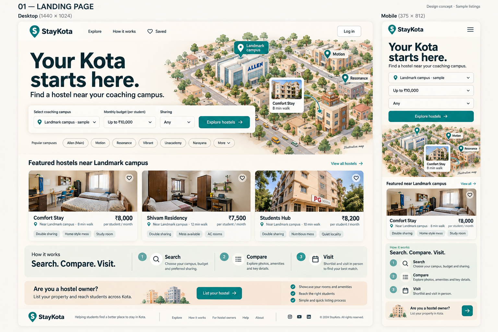
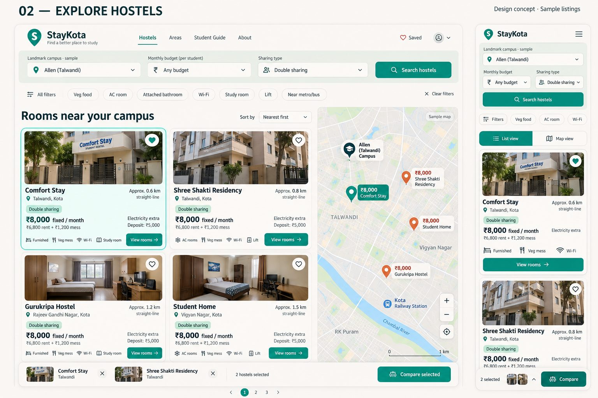
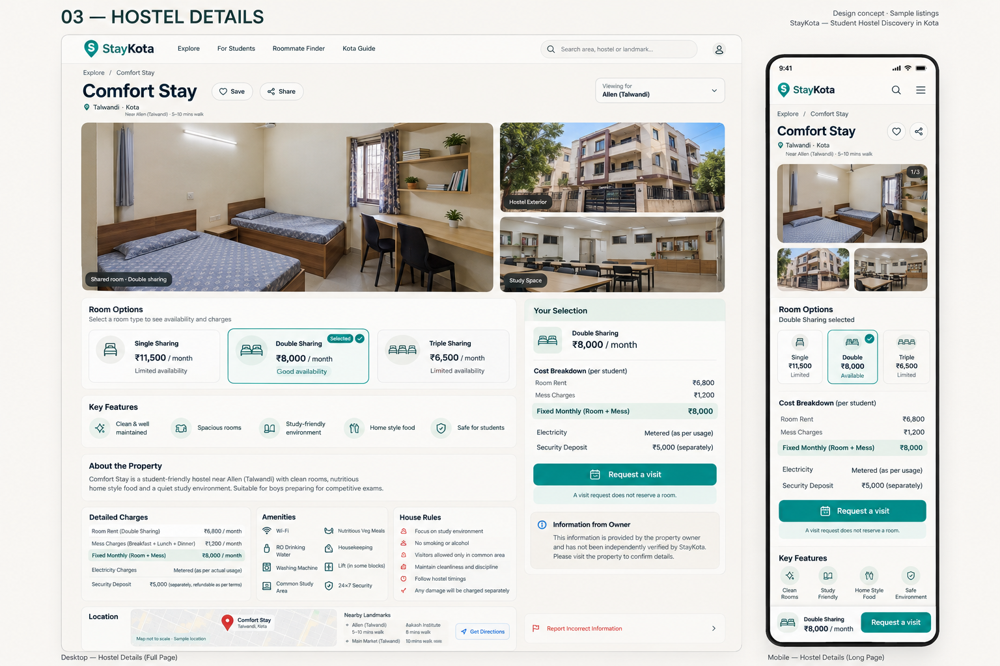
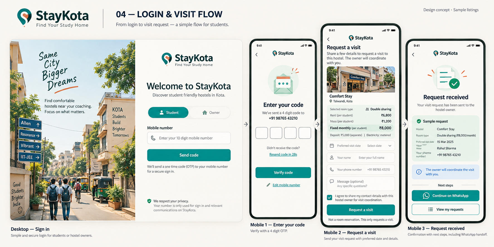
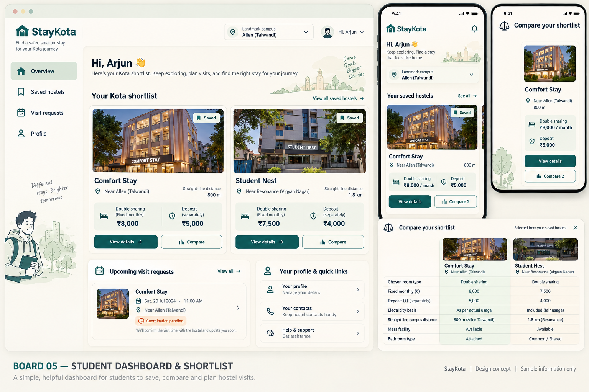
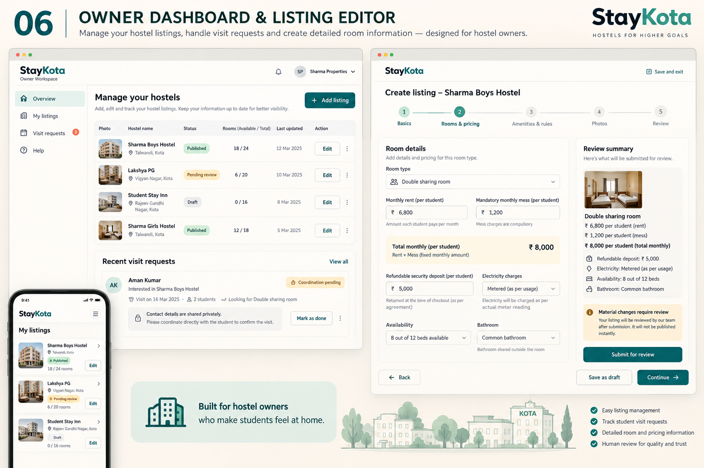
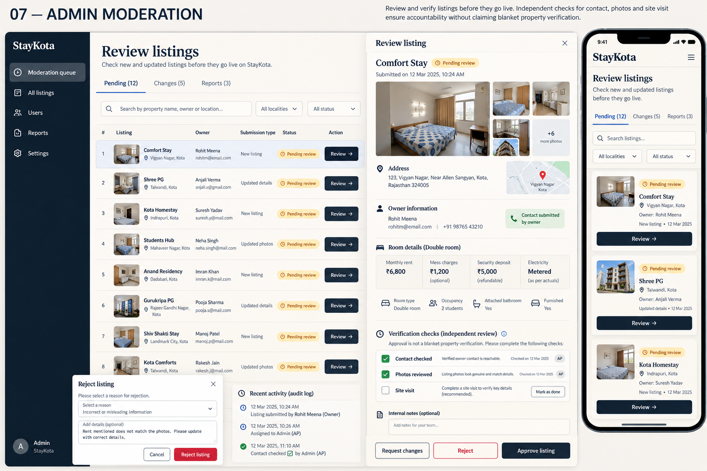
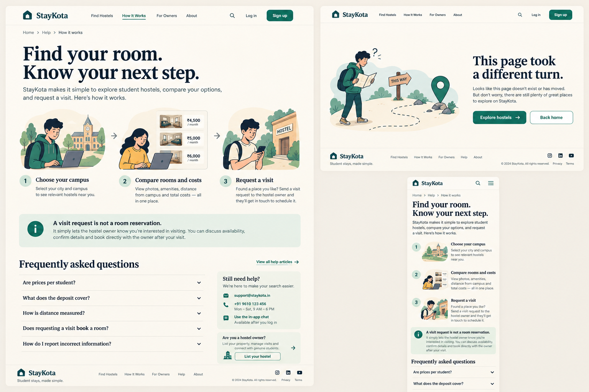

# StayKota design preview — v1

Eight PNG concept boards for review before implementation. All property names, photos, contact details, prices, dates, campus positions and distances are illustrative sample content. These are static mockups, not a functioning website. No application code was changed.

## 1. Landing page

[Open full-size PNG](01-landing-page.png)

## 2. Hostel search and map

[Open full-size PNG](02-explore-hostels.png)

## 3. Hostel details

[Open full-size PNG](03-hostel-details.png)

## 4. Login and visit request

[Open full-size PNG](04-login-and-visit-flow.png)

## 5. Student dashboard and comparison

[Open full-size PNG](05-student-dashboard-and-shortlist.png)

## 6. Owner dashboard and listing editor

[Open full-size PNG](06-owner-dashboard-and-editor.png)

## 7. Admin moderation

[Open full-size PNG](07-admin-moderation.png)

## 8. How it works and 404

[Open full-size PNG](08-how-it-works-and-404.png)

